# Data model

Mahnee keeps everything in one Cloudflare D1 (SQLite) database. Accounts come from
Cloudflare Access: there is no table of users, only rows keyed by the signed-in email.
Each schema change is a numbered file in `migrations/`.

```mermaid
erDiagram
  profiles ||--o| user_settings : "has"
  profiles ||--o{ profile_pictures : "has"
  profiles ||--o{ accounts : "has"
  profiles ||--o{ categories : "has"
  categories ||--o{ categories : "has subcategories"
  profiles ||--o{ transactions : "has"
  accounts ||--o{ transactions : "holds"
  categories ||--o{ transactions : "sorts"
  profiles ||--o{ change_receipts : "has"
  categories ||--o{ budgets : "has"
  profiles ||--o{ recurring : "has"
  profiles ||--o{ imports : "has"
  imports |o--o{ transactions : "added"
  accounts |o--o{ imports : "went into"
  accounts |o--o{ user_settings : "Add starts on"
  recurring |o--o{ user_settings : "month starts on"
  accounts ||--o{ recurring : "repeats on"
  categories ||--o{ recurring : "sorts"
  recurring |o--o{ transactions : "added"
  profiles ||--o| conversions : "converting"
  profiles ||--o{ conversion_staged : "worked out"
  profiles {
    TEXT email PK
    TEXT display_name "null, or 1 to 32 characters"
    INTEGER google_picture "1 shows the Google picture, 0 the initial"
    INTEGER created_at "ms"
    INTEGER updated_at "ms"
  }
  profile_pictures {
    TEXT email PK "and FK to profiles"
    TEXT source PK "upload or google"
    TEXT content_type "image/jpeg, image/png or image/webp"
    BLOB data "1 byte to 64 KB"
    INTEGER version "ms, after the one it replaced"
    TEXT google_url "where a Google picture was copied from; null for upload"
  }
  user_settings {
    TEXT email PK "and FK to profiles"
    TEXT currency "the home currency, one of HOME_CURRENCIES"
    TEXT theme "dark, light or auto"
    TEXT accent "cobalt, green, plum, rust or graphite"
    TEXT rate_preference "wise or ecb"
    TEXT week_start "monday or sunday"
    TEXT month_start_mode "date or payday"
    INTEGER month_start_day "1 to 28, or 31 for the last day"
    TEXT month_start_pay_id "FK with email to recurring; needed on payday"
    TEXT start_screen "home, activity or plan"
    TEXT home_density "essentials or everything"
    TEXT start_with "amount or category"
    TEXT default_account_id "FK with email to accounts; null for the last used"
    INTEGER suggest_as_you_type "0 or 1"
    INTEGER ask_for_time "0 or 1"
    TEXT expense_colour "ink or red"
    INTEGER carry_over_default "0 or 1"
    INTEGER daily_reminder "0 or 1"
    TEXT reminder_time "the person's clock, 00:00 to 23:59"
    INTEGER scheduled_reminder_days "null for none, or 1 to 7"
    TEXT time_zone "null until the app sends it, as Asia/Kuala_Lumpur"
    TEXT other_currencies "JSON list, at most 8, Add's order"
    INTEGER travel_sense "1 or 0, Add follows where the device is"
    INTEGER updated_at "ms"
  }
  accounts {
    TEXT email PK "and FK to profiles"
    TEXT id PK "16 hex characters, made by the app"
    TEXT name "1 to 40 characters"
    TEXT kind "cash, bank, card or ewallet"
    TEXT currency "the home currency"
    INTEGER opening_cents "within 1,000,000,000 either way"
    TEXT original_currency "null, or the currency it was typed in"
    INTEGER original_cents "what was typed, with original_currency"
    REAL rate "into the home currency, with original_currency"
    TEXT rate_source "wise or frankfurter, with original_currency"
    INTEGER rate_at "ms: the rate's day or time, with original_currency"
    INTEGER position "first at 0"
    INTEGER archived "0 or 1"
    INTEGER archived_at "ms, or null"
    INTEGER created_at "ms"
    INTEGER updated_at "ms"
  }
  categories {
    TEXT email PK "and FK to profiles"
    TEXT id PK "16 hex characters, made by the app or a default's"
    TEXT name "1 to 40 characters"
    TEXT kind "expense or income"
    TEXT parent_id "null at the top level; FK with email to categories"
    INTEGER position "among its siblings, first at 0"
    INTEGER archived "0 or 1"
    INTEGER created_at "ms"
    INTEGER updated_at "ms"
  }
  transactions {
    TEXT email PK "and FK to profiles"
    TEXT id PK "16 hex characters, made by the app"
    TEXT kind "expense, income or transfer"
    TEXT account_id "FK with email to accounts; a transfer's from"
    TEXT to_account_id "FK with email to accounts; a transfer's to, else null"
    INTEGER amount_cents "1 to 1,000,000,000"
    TEXT category_id "FK with email to categories; null only for a transfer"
    TEXT payee "null, or 1 to 80 characters"
    TEXT note "null, or 1 to 500 characters"
    TEXT date "the person's own day, as 2026-11-05"
    TEXT time "null, or the person's clock, as 20:12"
    TEXT import_id "null, or one of the person's imports"
    TEXT recurring_id "null, or one of the person's scheduled items"
    TEXT recurring_due "the day its occurrence was due; with recurring_id"
    INTEGER to_check "0 or 1: its amount is for the person to check"
    TEXT original_currency "null, or the currency it was typed in"
    INTEGER original_cents "what was typed, with original_currency"
    REAL rate "into the home currency, with original_currency"
    TEXT rate_source "wise or frankfurter, with original_currency"
    INTEGER rate_at "ms: the rate's day or time, with original_currency"
    INTEGER created_at "ms"
    INTEGER updated_at "ms"
  }
  imports {
    TEXT email PK "and FK to profiles"
    TEXT id PK "16 hex characters, made by the app"
    TEXT file_name "1 to 255 characters"
    TEXT account_id "FK with email to accounts; null for a Mahnee export"
    INTEGER added_count "0 to 5,000"
    INTEGER skipped_count "0 to 5,000"
    INTEGER created_at "ms"
    INTEGER undone_at "ms, or null"
  }
  budgets {
    TEXT email PK "and FK to profiles"
    TEXT category_id PK "FK with email to categories; top-level spending"
    TEXT from_month PK "the month it applies from, as 2026-11"
    INTEGER amount_cents "null for none from this month, or 1 to 1,000,000,000"
    INTEGER carry_over "0 or 1"
    TEXT original_currency "null, or the currency it was typed in"
    INTEGER original_cents "what was typed, with original_currency"
    REAL rate "into the home currency, with original_currency"
    TEXT rate_source "wise or frankfurter, with original_currency"
    INTEGER rate_at "ms: the rate's day or time, with original_currency"
    INTEGER updated_at "ms"
  }
  recurring {
    TEXT email PK "and FK to profiles"
    TEXT id PK "16 hex characters, made by the app"
    TEXT kind "expense, income or transfer"
    TEXT account_id "FK with email to accounts; a transfer's from"
    TEXT to_account_id "FK with email to accounts; a transfer's to, else null"
    INTEGER amount_cents "1 to 1,000,000,000"
    TEXT category_id "FK with email to categories; null only for a transfer"
    TEXT payee "null, or 1 to 80 characters"
    TEXT schedule "monthly or weekly"
    INTEGER day "1 to 31 of a month, or 1 (Monday) to 7"
    TEXT start_date "the day it was set up from, or imported"
    TEXT next_due "the next occurrence not logged or skipped"
    INTEGER position "set up in this order, first at 0"
    INTEGER archived "0 or 1: stopped repeating"
    INTEGER amount_varies "0 or 1: it changes, added to check"
    INTEGER ask_first "0 or 1: waits for Log it or Skip"
    TEXT original_currency "null, or the currency it was typed in"
    INTEGER original_cents "what was typed, with original_currency"
    REAL rate "into the home currency, with original_currency"
    TEXT rate_source "wise or frankfurter, with original_currency"
    INTEGER rate_at "ms: the rate's day or time, with original_currency"
    INTEGER created_at "ms"
    INTEGER updated_at "ms"
  }
  conversions {
    TEXT email PK "and FK to profiles"
    TEXT from_currency "the home currency before"
    TEXT to_currency "the new one"
    INTEGER since "ms: when it changed"
    TEXT phase "converting or refused"
    TEXT after_date "how far through the transactions"
    TEXT after_id "with after_date"
    INTEGER touched_at "ms: when it last moved on, or its next try is due"
    INTEGER restarts "times started again: stalled, or found incomplete"
    TEXT refused "amount, opening, budget, scheduled or rates; when refused"
  }
  conversion_staged {
    TEXT email PK "and FK to profiles"
    TEXT kind PK "transaction, account, budget or recurring"
    TEXT key PK "its id, or a budget's category/month"
    INTEGER cents "in the new currency"
    TEXT original_currency "and the rest as on its row"
  }
  change_receipts {
    TEXT email PK "and FK to profiles"
    TEXT change_id PK "the app's id for the change"
    TEXT fingerprint "SHA-256 of the change as sent"
    INTEGER saved_at "ms"
  }
```

## Tables

- **`profiles`**: one row per account, made the first time it saves anything. Until
  then the API answers with the defaults, so an account that has only signed in has no
  rows at all (unless its sign-in brought a Google picture, copied at once).
  `google_picture` says what shows when there's no chosen picture: the Google picture (1,
  the default) or the initial (0).
- **`profile_pictures`**: the picture shown in place of the initial (migration 0010). At most one per source: `upload`, the one
  the person chose, and `google`, a copy of the Google picture their sign-in names, with
  the address it came from (`google_url`), so it's copied again only when that changes.
  The chosen one shows, else the Google one while `google_picture` is 1, else the
  initial; choosing either of those deletes the chosen one. Each is a JPEG, PNG or WebP
  of at most 64 KB and 512px a side (the server checks the bytes; the table holds the
  type and size), kept in D1 rather than file storage since it's this small. `version` is
  when it was saved, always after the one it replaced, and names the copy browsers keep.
  Deleting a profile deletes them.
- **`user_settings`**: the account's private preferences, which follow it between
  devices. A first row is written with every setting, the changed ones and the defaults
  from `DEFAULT_SETTINGS` in `shared/api.ts` for the rest, so the defaults live in one
  place; the columns' own defaults are only a fallback. Deleting a profile deletes its
  settings. Each column has a CHECK holding what `shared/settings.ts` takes (the migration
  test keeps them in step). Two name the person's own rows, by foreign keys with the
  email: `default_account_id`, the account Add starts on (null for the last one used),
  and `month_start_pay_id`, the scheduled pay a month on payday follows (a running monthly
  income, which the Worker checks; the table needs one while `month_start_mode` is
  `payday`). Archiving that account sets `default_account_id` back to null, and a pay
  that stops or turns weekly puts the month back on `month_start_day`, the pay kept, in
  the same batch as the change. `month_start_day` 31 means each month's last day.
  `time_zone` is sent by the app at start, from the device, and is null until then.
  Migration 0007 rebuilt the table with the redesign's settings, mapping every accent to
  cobalt except green.
- **`accounts`**: where a person's money is, or what they owe on a card (a card's
  opening balance is below zero). Keyed by email and then id, so an id is only looked up
  among the person's own. Archived, never deleted; at most 50 per person, archived ones
  included. A balance is the opening balance plus what's come in and gone out, worked out
  when read and never stored. Saving the first one makes the profile row. `archived_at`
  is when it was archived, set by the server as it saves the change (never from the
  change), kept while it stays archived (archived again or renamed) and null once it's
  back; the table refuses one on a running account. Accounts archived before migration
  0008 have none, since `updated_at` moves with any edit, and read only "archived".
  Export and import carry no archived day.
- **`categories`**: what spending and income are sorted into, one level deep: a
  top-level category (`parent_id` NULL) can have subcategories, each the same kind as its
  parent and with none of its own. `(email, parent_id)` refers to `(email, id)`, so a
  parent is always one of the person's own, and triggers refuse a parent that isn't a
  top-level category of the same kind, or a category with subcategories going under
  another. Keyed by email and then id, like accounts. Archived, never deleted; at most
  200 per person and 50 under one category, archived ones included. A position orders a
  category among its siblings (same kind and parent). The defaults (`DEFAULT_CATEGORIES`
  in `shared/categories.ts`, the same ids for everyone) are saved with a person's first
  change of any kind; until then there are no rows and the app shows the defaults.
- **`transactions`**: money spent from an account (`expense`) or that came into one
  (`income`), in a category of the same kind, top level or a subcategory; or money moved
  from one of the person's accounts (`account_id`) to another (`to_account_id`), a
  `transfer`, with no category, which is never spending or income. The amount is
  always above zero; the kind says which way it went. `date` is the day on the person's
  own calendar, from 2000 to tomorrow in UTC. Keyed by email and then id, and its
  accounts and category are foreign keys with the email, so they're always the person's
  own. At most 100,000 on one account, a transfer counted on both, checked again as each
  row is saved. Deleted for good when
  the person deletes one (Undo adds it again with the same id). An account's balance is
  its opening balance plus its income and transfers in, less its spending and transfers
  out, summed when read. Indexed for an account's newest first, by day and then time
  (by `account_id`; the transfers into an account are found by scanning the person's rows)
  and for a month across accounts. `time` is the time of day on the person's clock when
  they add times ("Ask for a time"), null otherwise (and for everything from before); lists
  order a day's rows by it, latest first, those with none after (`ifnull(time, '')`), then
  by when saved and id, and the place a page carries on from names all four. `import_id` names the
  import it came in with; triggers refuse one that isn't the person's own (SQLite can't
  add a foreign key with the email to an existing table), and are indexed to undo one.
  `recurring_id` and `recurring_due` name the scheduled occurrence an entry came from (the
  nightly job's, or Log it's), both or neither, and triggers hold the item to one of the
  person's own; `to_check` is 1 only on one from Scheduled whose amount changes, until the
  person confirms or changes the amount.
- **`budgets`**: a monthly amount a person means to spend in a top-level spending
  category, its subcategories counting toward it. One row per category and month it was
  set in (`from_month`): the amount applies from that month on, until a later row, so
  earlier months keep what they had; setting one removes the category's rows for later
  months. A NULL amount takes the budget away from that month on. With `carry_over`, the
  month before's leftover (or overspending) is added, worked out when read
  (`shared/budgets.ts`), never stored. `(email, category_id)` refers to the person's
  categories, and a trigger refuses a row on anything but one of their top-level spending
  categories (archived ones allowed, so a budget can be taken away from one). A budget on
  a category later moved under another is kept but set aside until it's back at the top
  level.
- **`recurring`**: bills and income that repeat, monthly on a day of the month (the
  month's last day when it's shorter) or weekly on a weekday (1 Monday to 7 Sunday), with
  what's added each time, written like a transaction's columns and checked the same way.
  The nightly job (`worker/ledger/post-scheduled.ts`, a cron trigger every 15 minutes) adds
  each occurrence on its day where the person is (`user_settings.time_zone`), as Log it
  does: saving its transaction and moving `next_due` on in one batch, only from the
  occurrence it names (`next_due` is NULL otherwise, which the table refuses), so it's never
  recorded twice; skipping moves it on alone. `ask_first` items (0009 set it on those
  overdue the day it ran; since, one saved, moved back or brought back with its day passed)
  wait for Log it or Skip instead, until moved past the person's today. `amount_varies`
  marks what's added to check. The job reads only running items not asking first, each
  person's due by their own day, at most 200 a run; no index of its own (a person has at
  most 200 items, scanned from the zones the people have). Stopped (archived), never deleted; at most 200 per person, stopped ones included,
  checked again as each row is saved. Keyed by email and then id, its accounts and category
  foreign keys with the email. Read with the accounts (`GET /api/accounts`, only for someone
  who has any).
- **`imports`**: one row per file imported that added a transaction, so every device lists
  recent imports (`GET /api/imports`, those not undone, newest first, at most 10): the
  file's name (trimmed, 1 to 255 characters), the account a bank's file went into (null for
  a Mahnee export, which names its accounts), how many transactions it added and how many
  of the file's transaction lines it left out (each at most `MAX_IMPORT_ROWS`), when (the
  server's clock), and when it was undone. Recorded by `addImport` before the transactions
  that name it, in the same ordered changes. `undoImport` deletes every transaction whose
  `import_id` is it and sets `undone_at`, in one batch; once undone, nothing more goes and no
  transaction may name it. Keyed by email and then id, so two people's imports never meet.
  Deleting one keeps its transactions, their `import_id` set back to null.
- **`conversions`** and **`conversion_staged`**: changing the home currency
  (`user_settings.currency`, saved at once) writes a `conversions` row, phase `converting`,
  and the person's amounts are converted in the background (`worker/currency/convert.ts`,
  from the `mahnee-reconvert` queue): a page of transactions at a time, by day then id
  (`after_date`, `after_id`), each worked out into `conversion_staged` and checked against
  its limit, then the opening balances, budgets and scheduled items, and all of them
  swapped into their rows in one batch, the accounts' `currency` with them, before both go.
  Meanwhile the person's writes wait (the API answers 503) and the nightly job skips them,
  so what's worked out stays true. One amount past its limit refuses the whole change: the
  currency goes back, nothing is swapped, and the row stays as `refused`, naming the limit,
  until the next change; so does one the queue gave up on, or that stalled more than 3
  times (`rates`).
- **What an amount was typed as.** `transactions.amount_cents`, `accounts.opening_cents`,
  `budgets.amount_cents` and `recurring.amount_cents` each have `original_currency`,
  `original_cents`, `rate`, `rate_source` and `rate_at` (0011), all null for an amount typed
  in the home currency. A converted one is converted again from what it was typed as, and
  one typed in the new currency is plain again, so changing back restores it exactly.
  Changing the amount outside a conversion (no `converting` row) makes it typed in the home
  currency: triggers let go of what it was.
- **`change_receipts`**: one per change the app saved through `POST /api/changes`, by
  the id the app gave it, with the change's fingerprint, saved in the same batch as the
  change. A change sent again counts once; the same id with a different change is
  refused. Each person's receipts older than 90 days are let go when they next save.

## Conventions

- Times are whole milliseconds since 1970 (`*_at`).
- Money is whole cents in `*_cents` columns (see Money in `AGENTS.md`).
- Every row belongs to one account, and every query is scoped by it.

## Other currencies

`user_settings.other_currencies` (0012) is the person's list of other currencies, a JSON
array in their order, at most `MAX_OTHER_CURRENCIES` (8), each one of `ENTRY_CURRENCIES`
(`shared/rates.ts`: the home currencies, TWD and VND), never the home currency, checked by
the Worker; a home-currency change drops the new one from it when it's done. An entry typed
in one of them (or a one-off) is sent with that currency as its change's own (`currencies`
in `POST /api/changes`), converted into the home currency at its own day's rate and saved
with what was typed in the transaction's `original_currency`, `original_cents`, `rate`,
`rate_source` and `rate_at` (0011), as Splitfoolish's items keep theirs. An amount typed in
the home currency later lets go of them. `travel_sense` (default 1) says whether Add follows
where the device is; what it decided today stays on the device.
