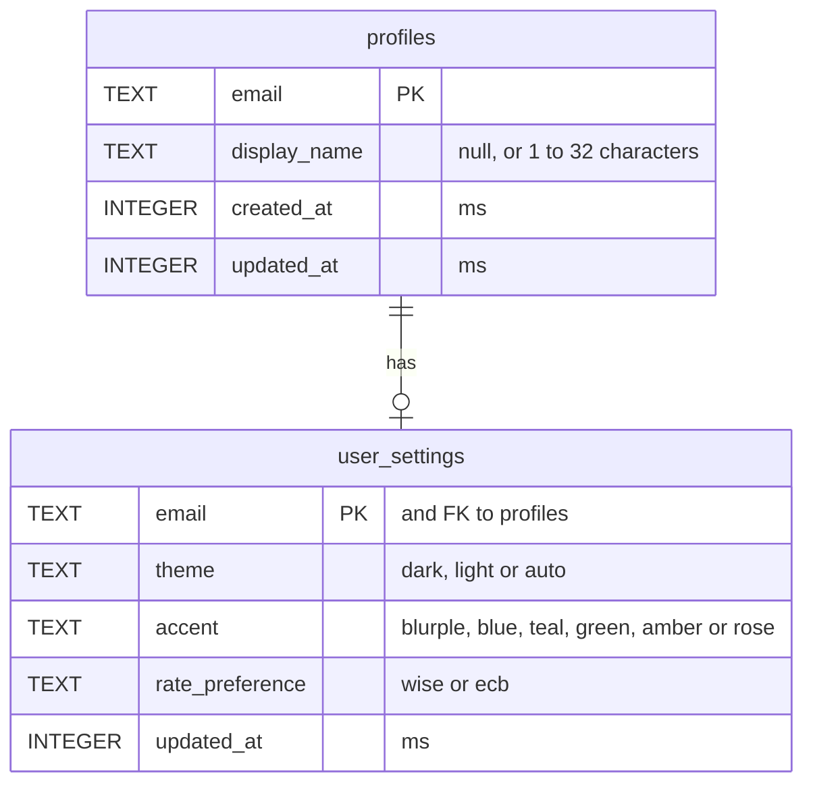

# Data model

Mahnee keeps everything in one Cloudflare D1 (SQLite) database. Accounts come from
Cloudflare Access: there is no table of users, only rows keyed by the signed-in email.
Each schema change is a numbered file in `migrations/`.

## Tables

- **`profiles`**: one row per account, made the first time it saves anything. Until
  then the API answers with the defaults, so an account that has only signed in has no
  rows at all.
- **`user_settings`**: the account's private preferences, which follow it between
  devices. A first row is written with every setting, the changed ones and the defaults
  from `DEFAULT_SETTINGS` in `shared/api.ts` for the rest, so the defaults live in one
  place; the columns' own defaults are only a fallback. Deleting a profile deletes its
  settings.

## Conventions

- Times are whole milliseconds since 1970 (`*_at`).
- Money, once there is any, is whole cents in `*_cents` columns (see Money in
  `AGENTS.md`).
- Every row belongs to one account, and every query is scoped by it.
