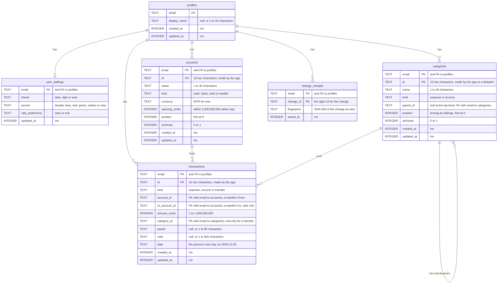

# Data model

Mahnee keeps everything in one Cloudflare D1 (SQLite) database. Accounts come from
Cloudflare Access: there is no table of users, only rows keyed by the signed-in email.
Each schema change is a numbered file in `migrations/`.

## Tables

- **`profiles`**: one row per account, made the first time it saves anything. Until
  then the API answers with the defaults, so an account that has only signed in has no
  rows at all.
- **`user_settings`**: the account's private preferences, which follow it between
  devices. A first row is written with every setting, the changed ones and the defaults
  from `DEFAULT_SETTINGS` in `shared/api.ts` for the rest, so the defaults live in one
  place; the columns' own defaults are only a fallback. Deleting a profile deletes its
  settings.
- **`accounts`**: where a person's money is, or what they owe on a card (a card's
  opening balance is below zero). Keyed by email and then id, so an id is only looked up
  among the person's own. Archived, never deleted; at most 50 per person, archived ones
  included. A balance is the opening balance plus what's come in and gone out, worked out
  when read and never stored. Saving the first one makes the profile row.
- **`categories`**: what spending and income are sorted into, one level deep: a
  top-level category (`parent_id` NULL) can have subcategories, each the same kind as its
  parent and with none of its own. `(email, parent_id)` refers to `(email, id)`, so a
  parent is always one of the person's own, and triggers refuse a parent that isn't a
  top-level category of the same kind, or a category with subcategories going under
  another. Keyed by email and then id, like accounts. Archived, never deleted; at most
  200 per person and 50 under one category, archived ones included. A position orders a
  category among its siblings (same kind and parent). The defaults (`DEFAULT_CATEGORIES`
  in `shared/categories.ts`, the same ids for everyone) are saved with a person's first
  change of any kind; until then there are no rows and the app shows the defaults.
- **`transactions`**: money spent from an account (`expense`) or that came into one
  (`income`), in a category of the same kind, top level or a subcategory; or money moved
  from one of the person's accounts (`account_id`) to another (`to_account_id`), a
  `transfer`, with no category, which is never spending or income. The amount is
  always above zero; the kind says which way it went. `date` is the day on the person's
  own calendar, from 2000 to tomorrow in UTC. Keyed by email and then id, and its
  accounts and category are foreign keys with the email, so they're always the person's
  own. At most 100,000 on one account, a transfer counted on both, checked again as each
  row is saved. Deleted for good when
  the person deletes one (Undo adds it again with the same id). An account's balance is
  its opening balance plus its income and transfers in, less its spending and transfers
  out, summed when read. Indexed for an account's newest first (by `account_id`; the
  transfers into an account are found by scanning the person's rows) and for a month
  across accounts.
- **`change_receipts`**: one per change the app saved through `POST /api/changes`, by
  the id the app gave it, with the change's fingerprint, saved in the same batch as the
  change. A change sent again counts once; the same id with a different change is
  refused. Each person's receipts older than 90 days are let go when they next save.

## Conventions

- Times are whole milliseconds since 1970 (`*_at`).
- Money is whole cents in `*_cents` columns (see Money in `AGENTS.md`).
- Every row belongs to one account, and every query is scoped by it.
